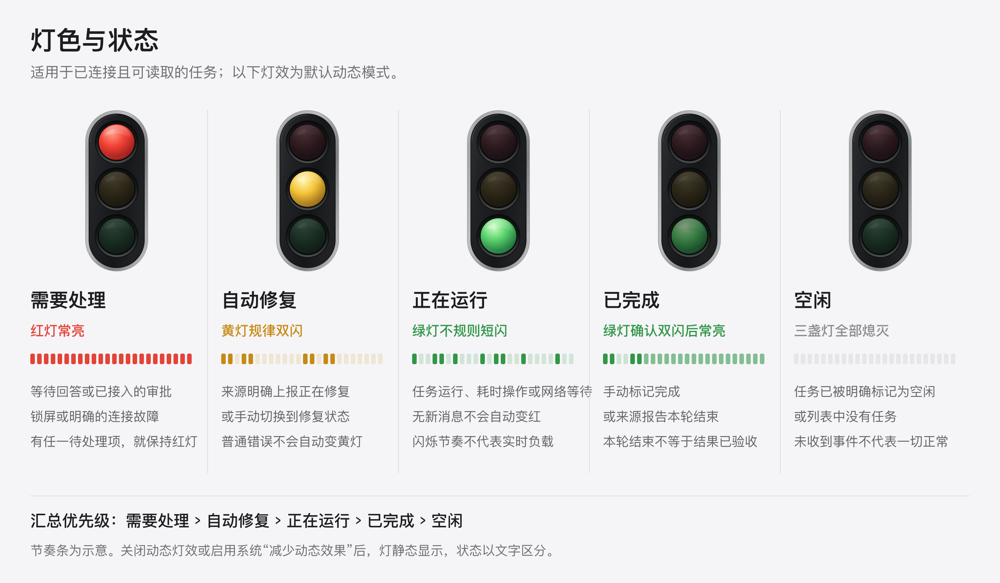
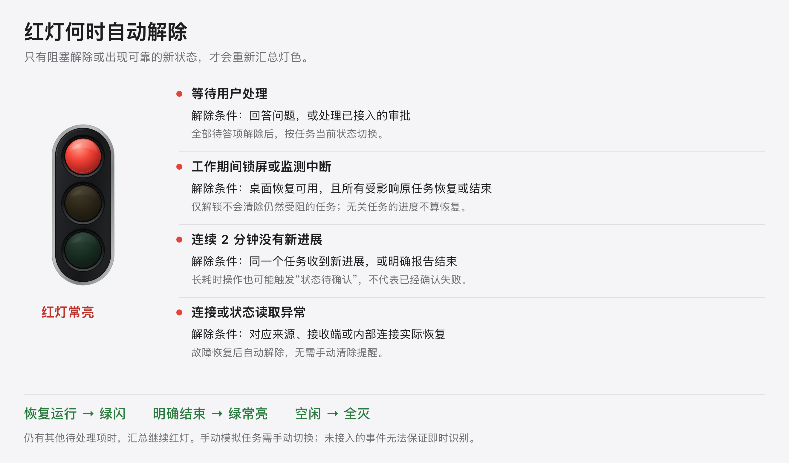

# AI Signal 0.1.4

桌面悬浮状态灯，支持拖动、置顶和任务状态汇总。Tauri 2 + React + Vite，优先 macOS，包含 Windows 实现。

## 灯色说明



| 灯色与灯效 | 什么时候出现 | 你需要做什么 |
| --- | --- | --- |
| **红灯常亮**，外围缓慢呼吸 | 等待你回答问题或处理已接入的审批；工作期间锁屏、连接异常 | 打开任务列表查看原因，在来源软件中处理。网络慢或耗时操作没有新消息，不会仅因此亮红灯。 |
| **黄灯规律双闪** | 来源**明确上报** AI 正在自动修复，或你手动选择“修复中” | 等待 AI 处理。普通错误不会被直接推断为自动修复。 |
| **绿灯不规则短闪** | 已识别任务正在运行，或原任务已恢复并产生新进展 | 可以继续自己的工作。闪烁为预设节奏，不代表实时 CPU、磁盘或工具调用负载。 |
| **绿灯确认双闪后低亮常亮** | 手动标记完成，或接入来源报告本轮结束 | 查看结果；本轮结束不等于整个任务已经完成或通过验收。 |
| **全部熄灭** | 没有任务，或所有任务均明确处于空闲 | 暂无已识别的活动。未连接、未上报或扫描范围外的任务不能据此判为空闲。 |

多任务按 **需要处理 → 自动修复 → 正在运行 → 已完成 → 空闲** 汇总，取最高优先级。例如，一个任务运行、另一个等待你回答时，最终显示红灯；最后一个待处理项解除后，才会切回其他任务对应的灯色。

关闭“动态灯效”或启用系统“减少动态效果”时，灯保持静态显示，运行和完成通过下方状态文字区分。两种灯体样式使用同一套状态逻辑。

## 红灯如何自动解除



- **等待回答**：回答全部问题后，按任务当前状态更新；问题“已受理”不等于你已经回答。
- **锁屏**：桌面恢复可用，且所有受影响的原任务恢复进展或明确结束后，自动解除。仅解锁或其他无关任务有进度，不会误清除提醒。
- **连接异常**：对应故障实际恢复后自动解除。

恢复运行时绿闪，明确结束时绿常亮，明确空闲时全灭；若仍有其他待处理项，汇总继续红灯。“已检查”保留为手动兜底，**手动模拟任务仍需手动切换**。

以上说明针对已连接、可读取或明确上报的事件，**不保证覆盖所有 Codex Desktop、远程或云端会话**；没有明确事件时保留最近明确状态，不会按消息间隔推断需要人工处理。更详细的边界见 [接入说明](docs/INTEGRATION.md)、[红灯修复验收](docs/ATTENTION-FIX.md)与[自动解除验收](docs/RECOVERY-FIX.md)。

## 任务识别与刷新

打开应用或连接 Codex 后自动同步近 24 小时更新过的本机会话。启动时完整恢复会话状态，之后每 3 秒读取新增记录，长任务不会因“开始运行”事件离文件末尾太远而漏识别。首次同步大历史时可能需要数秒。

「任务」和「连接」页均显示同步进度、最近成功同步时间，并提供 **刷新任务**。刷新会重新扫描会话，而不是只重载界面；不删除任务、不改变 Codex 的执行状态。仍缺少任务时，先检查「连接」中 Codex 是否启用、有无读取错误，以及任务是否在本机执行。云端、其他设备或无法读取的会话仍可能不在识别范围内。详见 [0.1.4 修复验收](docs/TASK-DISCOVERY-FIX.md)。

## 直接使用 macOS 应用

1. 解压随交付提供的 `AI-Signal-macOS-arm64.zip`。
2. 将 `AI Signal.app` 拖到「应用程序」，双击打开。
3. 桌面左上角会出现悬浮灯。按住灯体拖动，点击底部状态文字打开控制面板。
4. 在「任务」中手动模拟状态，或添加自己的任务。手动状态不是自动监控结果。
5. 在「外观」中调整灯体样式、大小、透明度、置顶、动态灯效和声音。「连接」中查看本机事件入口与接入说明。
6. 点击面板的系统关闭按钮会将面板隐藏到托盘，悬浮灯继续运行。使用菜单栏的交通灯图标显示、隐藏、置顶或退出应用。

交付包面向 macOS 12.3+ 的 Apple Silicon（M 系列）电脑。本地 MVP 未使用 Apple 开发者证书签名、未公证，不能视作已签名的公开发行版。如果 macOS 要求确认来源，请按系统的「隐私与安全性」说明处理；无需关闭系统安全保护。Intel Mac 可按下面步骤在 Intel 机器上构建。具体构建与运行结果见 [验收记录](docs/VALIDATION.md)。

控制面板分为「任务」「外观」「连接」三个标签页。默认「经典」样式为深色交通灯，也可在「外观」中切换到可爱扁平的「趣味」样式。样式选择会自动保存。

「动态灯效」默认开启，关闭后各状态保持静态显示，仍可从底部文字区分运行与完成。系统开启“减少动态效果”时自动停用动画。运行绿闪采用预设的不规则节奏，表示当前状态为运行中，不代表实时 CPU、磁盘或工具调用频率。

「外观」还支持置顶、70–160% 缩放、40–100% 不透明度和声音开关。进入红灯或绿常亮时可响一声。设置及手动任务保存在本机 WebView 存储中；外部事件仅在当前应用进程中保留；启用 Codex 连接后，会从本机重新识别仍在运行的会话。失联来源的任务可移除；同一来源再次上报会重新加入。

置顶适用于普通桌面窗口；全屏应用、系统安全界面、部分游戏及窗口管理策略可能影响置顶显示。开机启动本版未实现，可自行把应用加入 macOS「登录项」。拖动位置本版不持久化，重开后回到默认位置。

## 异常保护

用户输入请求与明确的锁屏错误优先显示红灯；异步问题的 `accepted` 只表示已显示，不能当作已经回答。未回答的问题不会被普通运行／结束事件覆盖。部分回答只解除对应问题；新的普通用户请求会结束上一轮遗留的等待。

原生监测每 2 秒读取桌面状态。明确识别到工作期间锁屏时，保留红灯提醒；桌面可用且所有受影响原任务恢复进展或明确结束后自动解除。锁屏提醒及任务关联跨重启保存。锁屏时普通窗口无法显示在系统安全界面上，解锁后如原任务仍未恢复，提醒继续保留；其他无关任务的进度不能解除它。没有活动任务时正常锁屏不会误报。

**网络慢、耗时操作、长时间无新消息或单纯监测间隔变长，不会自动转红，也不要求点击“已检查”。** 运行任务继续绿闪；修复任务保留黄灯。新事件到达后，按明确的运行、完成、空闲或待处理状态自动切换。来源读取失败、范围超限、必要接收端不可用和面板与原生进程通信失败也亮红灯，故障恢复后解除。纯手动任务不使用自动超时判断。

兼容解析不能覆盖全部软件状态。未知审批若没有明确事件，不按静默时长推断；应用退出、未连接来源及扫描范围外的任务无法保证提示。完整验证范围见 [修复验收](docs/ATTENTION-FIX.md)。

## 从源码运行

所需环境：Node.js 20.19+（建议 22 LTS）、npm、Rust stable。macOS 需要 Xcode Command Line Tools；Windows 需要 Visual Studio C++ Build Tools 和 WebView2。安装细节见 [Tauri 官方前置环境](https://v2.tauri.app/start/prerequisites/)。

```sh
cd ai-signal
npm ci
npm run desktop
```

`desktop` 会同时启动 Vite 和原生应用。若此前运行了 `npm run dev`，先停止占用 1420 端口的预览进程。应用退出请用托盘「退出 AI Signal」或终端 Ctrl+C。

只看可交互界面，不启用原生窗口、托盘或事件桥：

```sh
npm run dev
```

打开 `http://127.0.0.1:1420/`。悬浮灯页面为 `http://127.0.0.1:1420/?view=widget`。浏览器预览里的拖拽、置顶是桌面能力入口，不会影响浏览器窗口。

## 构建安装包

macOS，在对应芯片的 Mac 上运行：

```sh
npm run bundle -- --bundles app
```

输出：`src-tauri/target/release/bundle/macos/AI Signal.app`。需要 DMG 时可用 `npm run bundle -- --bundles dmg`。Intel 目标为 `x86_64-apple-darwin`；通用二进制目标为 `universal-apple-darwin`，需先安装对应 Rust targets 与 Apple 构建环境。

Windows，在安装好前置环境的 Windows 机器运行：

```powershell
npm ci
npm run bundle -- --bundles nsis
```

安装器输出至 `src-tauri/target/release/bundle/nsis/`。源码包含 Windows 原生窗口、托盘、提示音与适配器路径；本次没有 Windows 实机环境，尚未执行 Windows 构建或验收。

## Codex 自动联动

本地认证事件桥、原生 Hook 助手及 Python 通用适配器已实现，步骤与限制见 [接入说明](docs/INTEGRATION.md)。在「连接」中可启用 Codex 本机识别，或为 Claude Code 配置状态 Hooks。连接 Codex 不改动其配置；连接 Claude Code 会合并并备份用户级 Hooks，断开时仅移除本应用添加的部分。

```sh
python3 integrations/generate_hooks.py
python3 integrations/codex_hook.py --status running --task-id demo --title "联动测试" --strict
```

必须先运行桌面应用，第二条才可投递。Codex Hooks 还需要先在连接页启用 Codex。生成的 `hooks.example.json` 需审阅、合并到目标工作区并在 Codex 中信任。项目移动位置后重新生成配置。按 [官方 Hooks 文档](https://learn.chatgpt.com/docs/hooks) 支持的事件映射状态；`Stop` 只代表本轮结束，不保证业务任务完成。没有可靠的通用自修复事件，黄灯由明确上报触发。

Codex 会读取近期本机会话的生命周期记录，优先显示会话标题；只能兼容识别本机可读取且仍有更新的会话。Claude Code 需要先安装并运行一次，连接后在其信任的工作区继续或开始任务。

**本版不保证覆盖所有 Codex Desktop 会话。** 已验证的本地链路、真实 Hooks 验证状态与其他限制分别记录在验收文档中。

## 验证命令

```sh
npm run build
npm test
python3 -m unittest discover -s integrations -p 'test_*.py' -v
cd src-tauri
cargo test --release --lib
```

## 项目结构

```text
src/                 React 界面、矢量灯体、状态模型与本机存储
src-tauri/           Tauri 双窗口、托盘、声音、认证事件接收端
integrations/        Python Hook 适配器、配置生成器与测试
tests/               状态优先级、数据恢复、事件顺序测试
docs/                接入说明与验收记录
dist/                已构建的界面资源
```

应用不需要 OpenAI API key。仅在启用 Codex 连接后，本地读取会话生命周期记录和标题元数据；不上传对话正文。事件桥只监听 `127.0.0.1`，每次启动轮换令牌；Hook 只发送会话标识、目录名、显示状态与简短说明。浏览器请求来源会被事件桥拒绝。使用普通客户端认证请求对接外部脚本时，请勿把本机令牌上传或提交到仓库。
