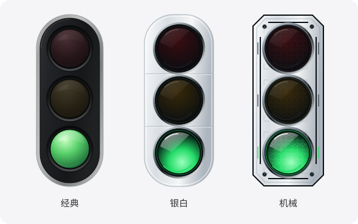

# 0.1.7：后台开销与竖版样式

## 已完成

- 设置窗口按需创建，关闭后销毁，释放对应 WebView；手动任务、连接和外观设置仍保留。重新打开回到任务页。
- 任务变化继续通过原生事件立即通知界面；完整快照的兜底校准由每 5 秒改为每 30 秒。显示或重新打开窗口时立即校准。
- 隐藏悬浮灯后停止其界面轮询，暂停不可见页面的灯效；后台监测继续运行。恢复显示时校准状态。
- 相同任务快照不触发界面更新，信号灯组件按属性复用。外观页的三个预览保持静态。
- 同步信息轮询由每秒改为每 3 秒，仅在设置窗口相应页面存在时运行。
- 会话标题索引按修改时间和长度缓存，未变化时只检查文件元数据；手动刷新会清除缓存。
- 监测状态直接比较，去掉每 2 秒重复的 JSON 序列化；没有运行任务且没有锁屏恢复提醒时不再查询桌面状态。

保留 Codex 每 3 秒的会话发现与增量读取、运行时每 2 秒的锁屏监测，不通过放慢这些检查来省资源。事件接收线程空闲时阻塞等待，不进行忙循环。没有新增依赖。

## 本机测量与验证

环境：Apple Silicon、macOS 26.3。2026-10-30，Rust 测试构建，对本机索引连续读取 100 次：

| 步骤 | 修改前 | 缓存预热后 |
| --- | --- | --- |
| 会话标题索引读取，100 次合计 | 189.44 ms | 0.437 ms |

同次测量中，目录发现平均 2.94 ms/次，发现 29 个近期文件。以上只衡量对应步骤，不能推导为整个应用或整机的 CPU、内存降幅。索引更新后仍需重新读取，首次完整恢复长会话仍有开销。

前端 10 项、后台 33 项、Python 事件适配 10 项测试通过；另运行本机只读性能测量。后台回归包含多任务冷启动、长日志、未回答问题、静默期间不误报、锁屏及自动恢复。生产前端和 macOS arm64 应用构建通过。

浏览器中已检查三款竖版外观、样式切换与重载保存。此次原生窗口操作未取得桌面响应，按需创建、销毁与重复打开设置窗口尚未完成桌面实测；整机 CPU、WebView 内存在相同负载下的对照测量也尚未完成。Windows 未构建实测，不承诺零占用或绝不影响性能。

## 样式

保留「经典」，新增「银白」「机械」，全部竖向排列：上红、中黄、下绿。移除「趣味」，旧设置自动改为经典，保留其他设置和任务。三款共用原有状态与灯效逻辑。

